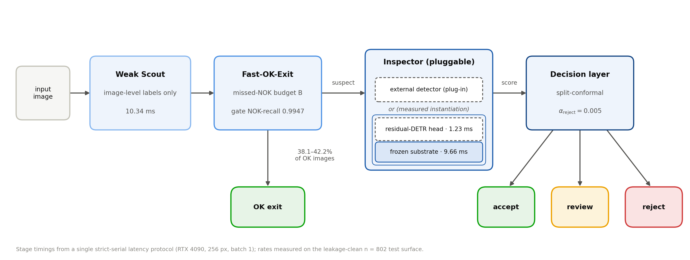

# Selective Inspection

This repository is the companion code of the paper *Learning When Not to Inspect: Risk-Calibrated Weak Supervision for Efficient Industrial Visual Inspection*: it trains the paper's weak scout from image-level OK/NOK labels, calibrates the Fast-OK-Exit gate and the split-conformal decision layer on validation scores, exports the scout to ONNX and runs the cascade with an inspector of your choice.



*Figure 1 of the paper: weak scout, Fast-OK-Exit under a missed-NOK budget, pluggable inspector, conformal accept/review/reject layer.*

Read the paper: [Learning When Not to Inspect (PDF)](./paper.pdf).

An image goes through three stages:

1. **Weak scout.** A small image scorer (a DETR-style head over an ImageNet-pretrained ResNet-18) trained with binary cross-entropy on image-level OK/NOK labels only: no boxes, no masks. Its output is a score in `[0, 1]`, higher meaning more anomalous.
2. **Fast-OK-Exit gate.** An image whose scout score is below `tau_exit` is accepted as OK at once and skips everything downstream. `tau_exit` is the largest threshold that keeps the validation NOK images wrongly let out within a missed-NOK budget `B` that you choose (for example 0 % or 1 %).
3. **Inspector and decision layer.** The other images go to the inspector, any function that maps an image to an anomaly score. A split-conformal layer turns the score into accept, review or reject, with thresholds taken from validation OK scores and a finite-sample bound on the rate of OK images rejected.

`B`, the strictness of the decision layer and the choice of inspector are all set after training: changing them means recalibrating on stored validation scores, not retraining. The repository does not ship an inspector: the [cascade API](./inference.md#the-cascade) takes yours.

## Installation

```bash
git clone https://github.com/rosepetal-ai/rosepetal-research-selective-inspection.git
cd rosepetal-research-selective-inspection

python -m venv .venv
source .venv/bin/activate        # Windows: .venv\Scripts\activate
pip install -r requirements.txt
```

The package is not installed with pip: run its tools from the repository root as `python -m selective_inspection.<tool>`, or put the root on `PYTHONPATH` to import it.

## Requirements

- Python 3.10 or newer.
- The packages of `requirements.txt`: `torch>=2.0`, `timm>=0.9`, `numpy>=1.24`, `pyyaml>=6.0`, `pillow>=9.0`, `onnx>=1.14`, `onnxruntime>=1.15`. For a PyTorch build that matches your CUDA version, follow the [PyTorch installation guide](https://pytorch.org/get-started/locally/).
- A CUDA GPU for training; on the CPU, training is only practical for smoke tests. Inference runs on the CPU (PyTorch or ONNX Runtime) or the GPU.
- Network access the first time a model is built with `pretrained: true` (the default): `timm` downloads the ImageNet weights of ResNet-18 once. `--no-pretrained` skips the download for smoke runs.
- Your own images. No dataset is included; the paper uses [MVTec AD](https://www.mvtec.com/company/research/datasets/mvtec-ad), which you download from its official page.

## Documentation

| Page | Contents |
|------|----------|
| [Data and training](./training.md) | The manifest format, building splits, the synthetic dataset, the training recipe and its options, how many NOK labels you need, fine-tuning |
| [Calibration](./calibration.md) | The exit-gate rule, the conformal decision layer, their output files, realised test rates, running the thresholds in production |
| [Inference and deployment](./inference.md) | Preprocessing, scoring with PyTorch, ONNX export and parity check, the cascade API with your own inspector |
| [Paper results](./results.md) | What the paper measured, under which protocol, and what this repository can reproduce |

## Usage

The tools pass their results on as files (a checkpoint, JSONL scores, JSON thresholds), so the steps below chain through files under `runs/`.

### Data

Each split is a JSONL manifest, one image per line, with its path and an `ok` or `nok` label:

```json
{"image_path": "images/train/part_0001.png", "label": "ok"}
{"image_path": "images/train/part_0002.png", "label": "nok", "image_id": "part_0002"}
```

You need three disjoint manifests, `train.jsonl`, `val.jsonl` and `test.jsonl`, each with OK and NOK images: validation NOK scores calibrate the gate and validation OK scores calibrate the decision layer. [Data and training](./training.md#manifests) has the full format and how to build the splits for MVTec AD.

To try the whole chain without a dataset, generate a small synthetic one and train for 20 steps:

```bash
python examples/make_dummy_dataset.py --out data/dummy
python -m selective_inspection.train --config configs/train_default.yaml \
    --train-manifest data/dummy/train.jsonl --val-manifest data/dummy/val.jsonl \
    --max-steps 20 --batch-size 4 --device auto --out runs/smoke
```

### Training

`configs/train_default.yaml` holds the paper's recipe (ResNet-18 at 256×256, 1500 steps, batch size 16, AdamW with learning rate 1e-4, seed 1337):

```bash
python -m selective_inspection.train \
    --config configs/train_default.yaml \
    --train-manifest data/my_dataset/train.jsonl \
    --val-manifest data/my_dataset/val.jsonl \
    --device cuda \
    --out runs/scout_seed1337
```

The run writes `checkpoint.pt`, `predictions_val.jsonl` (the validation scores the calibration reads), `metrics_val.json` (validation image AUROC) and `resolved_config.json`. It prints a warning when the training manifest has fewer than 200 NOK images: in the paper, the scout is close to chance with 50 NOK labels or fewer.

### Calibration

Both thresholds are calibrated on the validation scores only:

```bash
# Exit gate, for missed-NOK budgets of 0 % and 1 %
python -m selective_inspection.calibrate_gate \
    --val-predictions runs/scout_seed1337/predictions_val.jsonl \
    --budget 0.0 0.01 \
    --out runs/scout_seed1337/gate.json

# Accept/review/reject layer
python -m selective_inspection.calibrate_conformal \
    --val-predictions runs/scout_seed1337/predictions_val.jsonl \
    --alpha-accept 0.10 --alpha-reject 0.005 \
    --out runs/scout_seed1337/conformal.json
```

Calibrate the decision layer on the validation scores of the model whose score it will judge: the inspector's in a real cascade, the scout's in the demo below.

### Evaluation

Score the test split once, then pass it to the calibration tools with `--test-predictions`: the thresholds stay those of validation, and the JSON adds the rates they give on the test images, without any adjustment.

```bash
python -m selective_inspection.infer --checkpoint runs/scout_seed1337/checkpoint.pt \
    --manifest data/my_dataset/test.jsonl --out runs/scout_seed1337/predictions_test.jsonl

python -m selective_inspection.calibrate_gate \
    --val-predictions runs/scout_seed1337/predictions_val.jsonl \
    --budget 0.0 0.01 \
    --test-predictions runs/scout_seed1337/predictions_test.jsonl \
    --out runs/scout_seed1337/gate.json

python -m selective_inspection.calibrate_conformal \
    --val-predictions runs/scout_seed1337/predictions_val.jsonl \
    --test-predictions runs/scout_seed1337/predictions_test.jsonl \
    --out runs/scout_seed1337/conformal.json
```

Finally, run the cascade over a manifest. The demo has no inspector: routed images are judged on their scout score.

```bash
python -m selective_inspection.pipeline --checkpoint runs/scout_seed1337/checkpoint.pt \
    --gate-json runs/scout_seed1337/gate.json --budget 0.0 \
    --conformal-json runs/scout_seed1337/conformal.json \
    --manifest data/my_dataset/test.jsonl --out runs/scout_seed1337/decisions.jsonl
```

To plug in a real inspector and deploy the scout as ONNX, see [Inference and deployment](./inference.md).

## Results

The paper measures everything on MVTec AD, with all 15 categories re-carved into its own label pools and one shared held-out test set of 802 images (614 OK, 188 NOK); thresholds are calibrated on a validation set of the same composition. As the paper notes, only its label-free baseline is comparable with the original unsupervised MVTec AD leaderboard.

- **Exit.** With a missed-NOK budget of 0 %, 38.1 % of the OK test images (234 of 614) exit before the inspector; with a budget of 1 % or less, 42.2 % (259 of 614). In both cases 187 of the 188 defective images are still routed to the inspector (exit-stage NOK recall 0.9947). These figures depend only on the scout and its calibration, not on the inspector. They come from a single training seed (1337).
- **How many NOK labels.** With the OK pool fixed, the scout's image AUROC is 0.512 with 50 NOK images (indistinguishable from chance), 0.860 with 200 and 0.9339 with the full pool of 727; at 100 it ranges from 0.569 to 0.810 across three training seeds. The paper advises collecting at least 200 image-level NOK labels.
- **Cost.** Under the paper's latency protocol (one RTX 4090, batch 1, 256 px), the exit lowers the mean cost per image by 15.1 % to 16.7 % and leaves the p95 latency unchanged (about 22.2 ms): it buys throughput, not latency.

The repository reproduces the scout, the gate and the decision layer. It does not include the paper's split manifests, the inspector used for the end-to-end measurements, the baselines or the latency harness. [Paper results](./results.md) lists every measurement with its protocol and limits.

## License

The repository's `LICENSE` file reads: "License: TBD by the authors."
